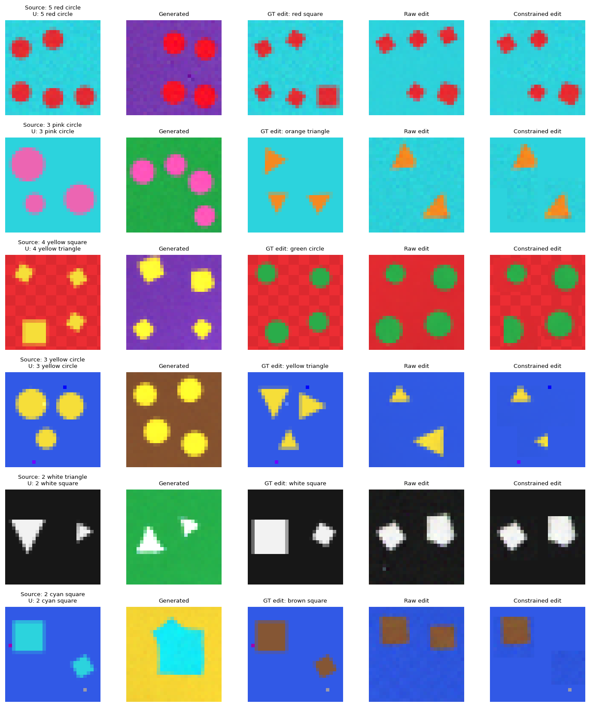

# tiny_umm：用28x28像素图训练理解-生成模型

> Agent模型不要修改此文件，由人类编写

`tiny_umm` 是个在简单图形toy dataset上从零开始训练的小型理解-生成多模态模型实验，采用BLIP-3o/MetaQuery结构。该项目的目的是：能快速验证不同训练策略、模型结构在UMM任务上能取得的效果以及暴露问题。在单个4060级显卡上就能试运行。

实现上，理解端用MLP，生成端用像素空间的条件Flow Matching，中间接一个 MetaQuery-lite 风格的 Query Connector，把理解端冻结的隐表示接到同样冻结的生成骨干上。

> 没有大型语言模型，没有自然语言 tokenizer，也没加载任何预训练权重。用总共 4 个离散的结构化token代替语言模型。

模型能处理的数据如下：

- 28×28×3 RGB图
    - 形状只有正方形、圆形、三角形
    - 颜色 11 种
    - 数量 1 到 5
    - 一张图里所有物体同色同形，互不遮挡

- 理解和编辑上述图片的指令，可以用4个token完全描述

编辑任务只改颜色和形状。数量、中心、外接框尺寸、排布、背景、噪声都保持原样。

## 1. 任务与数据

“文本”输入输出是顺序固定的四个分类式输出：

```text
[operation, count, color, shape]
```

- `operation`：`UNDERSTAND=0` / `GENERATE=1` / `EDIT=2`
- `count`：`1..5` / `KEEP` / `MASK`
- `color`：11 种颜色 / `MASK`
- `shape`：3 种形状 / `MASK`


| 任务 | 输入 | 输出 |
|---|---|---|
| 理解 | `[UNDERSTAND, MASK, MASK, MASK]` + 图片 | `[n, color, shape]` |
| 生成 | `[GENERATE, n, color, shape]` | 图片 |
| 编辑 | `[EDIT, KEEP, target_color, target_shape]` + 源图 | 保持其余内容的新图 |

理解任务的后三个槽位恒为 `MASK`，答案不会提前出现在 prompt 里，模型只能从图片里取。编辑时数量槽位填 `KEEP`，意思是不要猜数量，沿用源图。

每个离散字段各有一个独立 embedding，四个字段拼起来过一个小 MLP，融合成 instruction embedding。

图像：



效果：左一列为原始图片，可用于理解、编辑任务，第二列为文生图效果，第三列为左一图像编辑的Prompt和目标，第四、第五列是实际编辑的结果


数据集可以由`data/build_dataset.py`构建，默认构建的数据集情况如下：

| split | 场景数 | 条目数 | 说明 |
|---|---:|---:|---|
| train | 40,000 | 120,000 | 普通组合 |
| val | 5,000 | 15,000 | 选 checkpoint |
| test_random | 4,000 | 12,000 | 普通组合，最终报告 |
| test_comp | 1,000 | 3,000 | 12 个留出 (count,color,shape) 组合 |
| **合计** | **50,000** | **150,000** | |


## 3. 模型

### 3.1 理解 MLP（`models/understanding.py`）

```text
image 2352 -> 512 -> 512 -> 256 (LayerNorm + GELU + dropout) -> h
prompt 4 tokens -> embedding -> MLP
[h, prompt_embedding] -> count(5) / color(11) / shape(3) heads
```

### 3.2 条件 Flow（`models/flow.py`）

参考 [Michedev/flow-matching-mnist](https://github.com/Michedev/flow-matching-mnist) 的条件 U-Net
思路，实现适配 28×28 RGB 和四槽指令的轻量像素 U-Net。训练时从高斯噪声 `x0` 和目标图 `x1`
构造线性路径 `x(t) = (1 - t) * x0 + t * x1`，回归速度 `x1 - x0`；采样时默认用中点法
从 0 积分到 1。时间与指令控制残差块，4 个视觉 token 通过瓶颈的交叉注意力输入。


### 3.3 Query Connector（`models/connector.py`）

```text
h = E_MLP(x_src)                    # 冻结理解骨干
z_k = q_k + P_phi([q_k, h, e_instruction]), k = 1..4
Z = [z_1, ..., z_4]
```

`q_k` 是 4 个可学习 query，`P_phi` 是共享的小 MLP。生成使用 null visual tokens；编辑使用源图
`h`。阶段 C 冻结理解 MLP、Flow 参数以及 Stage-B 的 instruction encoder，只训练 connector
（0.79M）；Flow 的 forward **不包在 `no_grad` 里**，只有参数被冻结，因此梯度可以穿过 Flow
回到 connector。


### 3.4 编辑

默认由 connector 传递源图信息。推理只读取源图、目标指令和可选的用户区域。未提供区域时，从源图估计可编辑范围。

## 4. 训练阶段

| 阶段 | 训练对象 | 冻结 | 损失 | 数据 |
|---|---|---|---|---|
| A | 理解 MLP + prompt encoder | — | 三个 CE 之和 | 40K 理解任务 |
| B | 条件 Flow + 源 token encoder + 直接通路 + instruction encoder | — | FM | 40K 生成 + 40K 编辑混合 |
| C | Query Connector（配置默认仅 connector 可训练） | U、Flow、instruction | FM（梯度穿过冻结 Flow） | 编辑 + 30% 生成混合 |
| C'（基线） | DiscreteBridge | U、Flow、instruction | FM | 同上 |
| C-joint（消融） | Connector + instruction encoder | U、Flow 参数 | FM | 同上 |
| D（可选） | connector + Flow 条件适配层 | U、Flow 主体 | FM | 仅当 C 明显下降 |

## 后续拓展

也许会拓展到CIFAR-10等toyset上